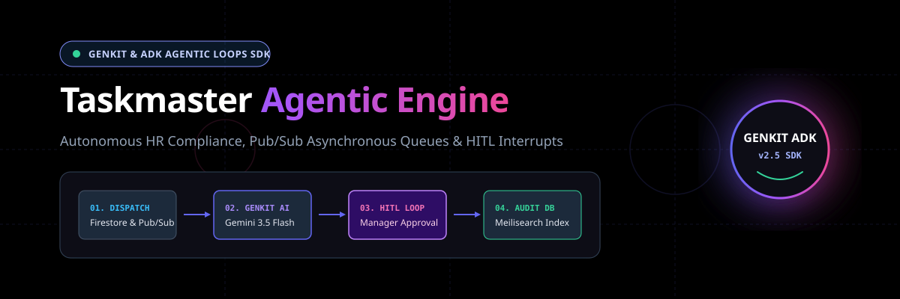

<p align="center">
  
</p>

# Taskmaster Agent

[](https://firebase.google.com/docs/genkit)
[](https://ai.google.dev)
[](https://devpost.com)
[](/docs/ARCHITECTURE.md)
[](LICENSE)

- **All Things Agentic Hackathon Submission — Track: Taskmaster**

An enterprise-grade, event-driven HR operations agent and autonomous loop engine built with **Google Genkit**, calling the Gemini API directly. The agent runs asynchronously across Cloud Run and Pub/Sub, handles heavy-duty HR compliance auditing over massive datasets via **Meilisearch** and **Cloud Firestore**, parses unstructured shift logs using **Gemini 3.6 Flash**, and enforces safe guardrails with **Human-in-the-Loop (HITL) interrupts**.

---

## 🏗️ Architecture & Devpost Submission Guide

- **4-Stage Pipeline**: *Dispatch (Pub/Sub)* $\rightarrow$ *Genkit AI Loop (Gemini 3.6 Flash)* $\rightarrow$ *HITL Interrupt (Manager Review)* $\rightarrow$ *Meilisearch Audit Indexing*. Include `/public/repo-banner.svg` or XML diagrams from [`/docs/ARCHITECTURE.md`](/docs/ARCHITECTURE.md) in your Devpost image gallery.
- **Human-in-the-Loop (HITL) Differentiator**: Taskmaster avoids "black box" failure by detecting labor violations (e.g. overtime > 10 hours), safely pausing execution, preserving conversation state, and awaiting supervisor verification (`approved` / `rejected`) before finalizing payroll.

---

## 👥 How to Add Employee Records

Employee records can be added and managed in three ways:

1. **Out-of-the-Box Demo Records**: Pre-configured defaults (`emp_001` Alice Chen, `emp_002` John Smith, `emp_003` Maria Garcia) are automatically loaded in memory and Firestore.
2. **Database Seeding (`npm run seed`)**: Run `npm run seed` to populate corporate policies and employee timesheet records into Cloud Firestore and Meilisearch.
3. **API Insertion (`POST /employees` or Firestore)**: Directly upsert employee records with base rates, regular hours, and overtime hours:

   ```json
   {
     "id": "emp_004",
     "name": "Sarah Connor",
     "department": "Security",
     "baseRate": 45.0,
     "regularHours": 160.0,
     "overtimeHours": 12.5,
     "overtimeApproved": false
   }
   ```

---

## 🚀 Key Features

- **Autonomous Agentic Loops (`Genkit` + `Gemini 3.6 Flash`)** – The AI model dynamically reasons over commands, evaluates tools (`search_policies`, `get_employee_record`, `resolve_overtime`), and iterates up to `maxTurns: 6`.
- **Event-Driven Pub/Sub & Cloud Run Architecture** – Asynchronous job dispatching ensures clients never block. Pub/Sub pushes event payloads to Cloud Run workers for horizontal scalability.
- **Restartable HITL Interrupts** – When overtime thresholds are exceeded, Genkit pauses execution, preserves conversation history, and triggers supervisor review dashboards.
- **Real-Time Control Center UI** – Live web console built with Tailwind CSS displaying active job queues, employee timesheet databases, policy rulebooks, and interactive approval flows.

---

## 🛠️ Quick Start & Local Development

1. **Install Dependencies**

   ```bash
   npm install
   ```

2. **Configure Environment Variables**
   Run `npm run generate-secrets` to automatically generate API keys and bootstrap `.env`.
3. **Seed Demo Data & Policies**

   ```bash
   npm run seed
   ```

4. **Start the Development Server**

   ```bash
   npm run dev
   ```

   Open `http://localhost:3000` to access the interactive **HR Ops Control Center**.

---

## 📡 API Endpoints

- **`POST /jobs`** – Submit an asynchronous HR directive.
- **`GET /jobs`** – List all jobs and execution states.
- **`GET /jobs/:jobId`** – Get single job details and audit trail.
- **`POST /jobs/:jobId/resume`** – Resume a paused HITL job with a manager decision (`approved` / `rejected`).
- **`POST /tasks/run`** – Pub/Sub push webhook endpoint triggering the Cloud Run worker.

---

## 📄 License

MIT
